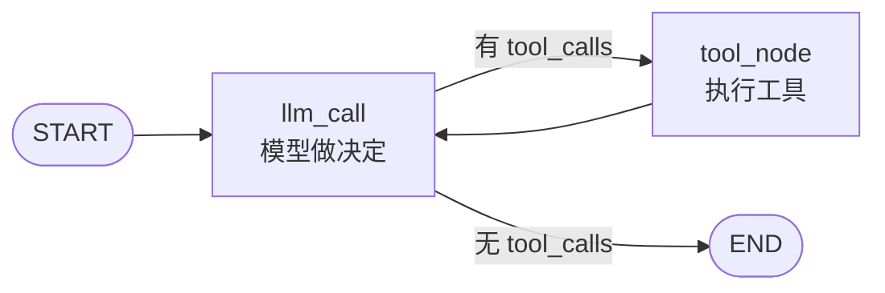

# 从零跑通一个 Agent Demo：50 行代码看懂「工具调用循环」

很多人第一次接触 Agent，会被「规划」「记忆」「多智能体」这些词吓住。其实剥掉包装，一个能干活的最小 Agent 只有三样东西：

1. **一个会做决定的模型**（决定「直接回答」还是「调用工具」）
2. **一组工具**（真正执行动作的普通函数）
3. **一个循环**（调用工具后把结果还给模型，直到模型不再要工具）

这篇就带你从零跑通一个这样的 Demo：一个会算数的 Agent。代码不到 50 行，用的是 LangGraph 的 Graph API，跑通之后你会对 Agent 的运转方式有非常具体的认识。



这个圈就是 Agent 的本质。所有「自主」「多步推理」的能力，都是从这一个圈里长出来的。

---

## 一、环境准备

要求：Python 3.11+，一个支持 Function Calling 的模型 API Key。

国内最省事的组合是 DeepSeek（OpenAI 兼容接口，注册即用），通义千问的百炼平台也一样。文章里的代码两者都能跑，换 `.env` 里三行配置即可。

```bash
# 1. 建目录、装依赖（用 uv，比 pip 快很多；没有的话 pip install uv）
mkdir agent-demo && cd agent-demo
uv venv
uv pip install langgraph langchain langchain-openai python-dotenv
```

```bash
# 2. 配置密钥
# .env
OPENAI_API_KEY=sk-你的-key
MODEL_NAME=deepseek-chat
MODEL_BASE_URL=https://api.deepseek.com/v1
```

> 用通义千问：`MODEL_NAME=qwen-plus`，`MODEL_BASE_URL=https://dashscope.aliyuncs.com/compatible-mode/v1`。

依赖清单（本 Demo 验证时的版本见仓库 `requirements.txt`）：

```
langgraph>=1.0
langchain>=1.0
langchain-openai>=1.0
python-dotenv>=1.0
```

---

## 二、第一步：让模型「有手」

先定义工具。LangChain 的 `@tool` 装饰器会把普通函数包装成模型能理解的工具，**函数的 docstring 就是模型看到的工具说明**，所以要写清楚用途和参数。

```python
from langchain.tools import tool

@tool
def add(a: int, b: int) -> int:
    """计算两个整数之和。"""
    return a + b

@tool
def multiply(a: int, b: int) -> int:
    """计算两个整数之积。"""
    return a * b

@tool
def divide(a: int, b: int) -> float:
    """计算 a 除以 b，b 不能为 0。"""
    if b == 0:
        raise ValueError("除数不能为 0")
    return a / b

tools = [add, multiply, divide]
tools_by_name = {t.name: t for t in tools}
```

然后把它挂到模型上：

```python
from langchain_openai import ChatOpenAI

model = ChatOpenAI(
    model="deepseek-chat",
    base_url="https://api.deepseek.com/v1",
    api_key="sk-...",
    temperature=0,
)
model_with_tools = model.bind_tools(tools)
```

`bind_tools` 之后，模型返回的 `AIMessage` 里就可能带上 `tool_calls` 字段——注意，它**不会真的执行函数**，只是告诉你「我想调 `multiply`，参数是 12 和 8」。真正的执行，是我们自己写的。

---

## 三、第二步：定义状态

LangGraph 的核心概念是「图 + 状态」。状态是一个字典，在节点之间传递；每个节点返回「要更新哪些字段」。

```python
import operator
from typing import Annotated
from typing_extensions import TypedDict
from langchain.messages import AnyMessage

class MessagesState(TypedDict):
    messages: Annotated[list[AnyMessage], operator.add]
    llm_calls: int
```

两个关键点：

- `Annotated[..., operator.add]` 表示**追加**而不是覆盖。消息列表要越滚越长，不能每轮都被替换掉。
- `llm_calls` 用来数模型调用次数，方便观察循环了几圈，不加也完全能跑。

---

## 四、第三步：两个节点 + 一条条件边

**节点一：调用模型。** 把历史消息连同系统提示词丢给模型，把它的回复追加进状态。

```python
from langchain.messages import SystemMessage

def llm_call(state: MessagesState):
    return {
        "messages": [
            model_with_tools.invoke(
                [SystemMessage(content="你是一个算术助手。遇到算术问题必须调用工具计算，不要心算。")]
                + state["messages"]
            )
        ],
        "llm_calls": state.get("llm_calls", 0) + 1,
    }
```

**节点二：执行工具。** 只做一件事：看模型上一条消息里的 `tool_calls`，逐个执行，把结果包装成 `ToolMessage` 塞回去。

```python
from langchain.messages import ToolMessage

def tool_node(state: MessagesState):
    results = []
    for tool_call in state["messages"][-1].tool_calls:
        fn = tools_by_name[tool_call["name"]]
        observation = fn.invoke(tool_call["args"])
        results.append(
            ToolMessage(content=str(observation), tool_call_id=tool_call["id"])
        )
    return {"messages": results}
```

`tool_call_id` 不能省——模型靠它把「工具结果」和「自己刚才的请求」对上号，尤其是并行调多个工具时。

**条件边：决定继续还是结束。**

```python
from typing import Literal
from langgraph.graph import END

def should_continue(state: MessagesState) -> Literal["tool_node", END]:
    last_message = state["messages"][-1]
    return "tool_node" if last_message.tool_calls else END
```

模型还要工具 → 去 `tool_node`；不要了 → 结束。就这一行判断，撑起了整个 Agent 循环。

---

## 五、把它拼起来

```python
from langgraph.graph import StateGraph, START

builder = StateGraph(MessagesState)
builder.add_node("llm_call", llm_call)
builder.add_node("tool_node", tool_node)

builder.add_edge(START, "llm_call")
builder.add_conditional_edges("llm_call", should_continue, ["tool_node", END])
builder.add_edge("tool_node", "llm_call")

agent = builder.compile()
```

调用它：

```python
from langchain.messages import HumanMessage

result = agent.invoke(
    {"messages": [HumanMessage(content="先算 12 乘以 8，再加上 4，最后除以 5。")]},
    config={"recursion_limit": 10},
)

for msg in result["messages"]:
    msg.pretty_print()
```

`recursion_limit` 是我额外加的保险：万一模型陷入「一直要工具」的死循环，图会在 10 步后抛 `GraphRecursionError`，而不是无限烧钱。

---

## 六、运行结果

完整代码见仓库里的 [`agent.py`](./agent.py)，`uv run python agent.py`（或激活虚拟环境后 `python agent.py`）即可。

你会看到类似这样的过程（不同模型措辞略有差异）：

```
================================ Human Message ================================
先算 12 乘以 8，再加上 4，最后除以 5。
================================== Ai Message =================================
Tool Calls:
  multiply (call_xxx)
  Args: {"a": 12, "b": 8}
================================= Tool Message =================================
96
================================== Ai Message =================================
Tool Calls:
  add (call_yyy)
  Args: {"a": 96, "b": 4}
================================= Tool Message =================================
100
================================== Ai Message =================================
Tool Calls:
  divide (call_zzz)
  Args: {"a": 100, "b": 5}
================================= Tool Message =================================
20.0
================================== Ai Message =================================
12 × 8 = 96，96 + 4 = 100，100 ÷ 5 = 20。结果是 20。
```

模型调用了 4 次，工具执行了 3 次。把这段消息流倒过来看，就是前面那张图在现实中的运行轨迹。

---

## 七、踩坑排查表

跑不通基本逃不开下面几种情况，按现象对号入座：

| 现象 | 原因 | 解决 |
| --- | --- | --- |
| `AuthenticationError` / 401 | 没读到 Key，或 Key 无效 | 确认 `.env` 在运行目录下、`load_dotenv()` 已调用 |
| `404 Not Found` | `base_url` 写错 | DeepSeek 用 `https://api.deepseek.com/v1`，百炼用 `.../compatible-mode/v1` |
| 400 报 tool 相关错误 | 所选模型不支持 Function Calling | 换 `deepseek-chat`、`qwen-plus` 等支持工具调用的模型 |
| 模型「心算」不调工具 | 提示词约束不够 | 系统提示里明确「必须调用工具」；`temperature=0` |
| `GraphRecursionError` | 模型反复要工具 | 检查工具是否返回了模型看不懂的结果；必要时调大 `recursion_limit` |
| `ModuleNotFoundError: langchain_openai` | 少装包 | `uv pip install langchain-openai` |
| 一直卡住 / 连接超时 | 代理或网络 | 国内模型直连即可，检查系统代理是否拦截了 API 域名 |

还有一个隐蔽的坑：`@tool` 函数的 **docstring 是给模型看的**。参数名写错、说明含糊，模型就会传错参数——报错时先回头看 docstring。

---

## 八、跑通之后往哪走

这个 Demo 只保留了 Agent 最核心的骨架。真实项目里通常接着加这几样：

- **持久化（checkpointer）**：让多轮对话记住上下文，服务重启不丢。
- **流式输出（stream）**：把 token 和工具调用过程实时推给前端。
- **人类审批（interrupt）**：涉及转账、删数据这类操作，执行前暂停等确认。
- **接入现有后端**：把 `agent.invoke` 包成一个 HTTP 接口，Spring Boot 里用 `WebClient` 调用即可，Agent 和 Java 业务各管各的。

如果你是 Java 后端开发者，我的建议是先把这一个 Demo 亲自跑通、改坏、再修好——比看十篇架构文章都管用。

---

## 附：文件说明

```
agent-demo-from-scratch/
├── agent.py          # 完整示例
├── requirements.txt  # 依赖
├── .env.example      # 配置模板，复制为 .env 填 Key
└── README.md         # 本文
```

代码基于 LangGraph 1.2 / LangChain 1.5 的 Graph API 编写并实测运行通过。仓库可以随意 fork、改工具（把 `add/multiply/divide` 换成查数据库、调接口），循环逻辑完全不用动。
